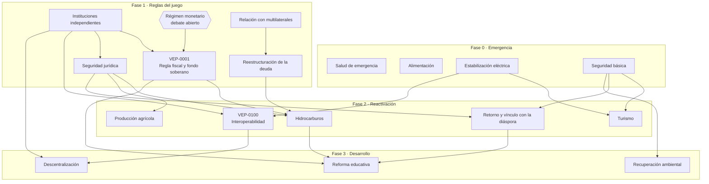

# Hoja de ruta

> **Esto es una propuesta de secuenciación para debatir, no un plan cerrado.** Se modifica mediante una VEP del área `governance`, como cualquier otro documento del proyecto.

Ninguna reforma funciona aislada. Un fondo soberano no sobrevive sin instituciones que lo protejan, la inversión no llega sin seguridad jurídica y la educación no mejora si los docentes no pueden vivir de su salario. Este documento propone **qué debería ir primero y por qué**, para que las propuestas se piensen como un conjunto y no como una lista de deseos.

---

## Principios de secuenciación

1. **Primero lo que salva vidas.** Salud, alimentación, agua y electricidad no pueden esperar a que se terminen las reformas de fondo.
2. **Después, las reglas del juego.** Sin instituciones confiables y estabilidad macroeconómica, las demás reformas no se sostienen.
3. **Las reformas rápidas financian a las lentas.** Lo que genera ingresos pronto (hidrocarburos, turismo, servicios digitales) ayuda a pagar lo que da frutos más tarde (educación, instituciones).
4. **Empezar en pequeño y escalar.** Los pilotos locales demuestran que algo funciona antes de llevarlo a todo el país.
5. **Algunas cosas se hacen en paralelo.** Las fases se solapan; la hoja de ruta indica prioridades, no un orden estricto.

---

## Fases

| Fase | Horizonte orientativo | Objetivo | Áreas protagonistas |
|------|-----------------------|----------|---------------------|
| **0. Emergencia** | Primeros meses | Proteger la vida y los servicios básicos | Salud, Agricultura y alimentación, Infraestructura, Seguridad ciudadana |
| **1. Reglas del juego** | Primer y segundo año | Instituciones confiables y estabilidad económica | Instituciones, Economía (régimen monetario y fiscal), Política exterior |
| **2. Reactivación** | Años 2 a 5 | Recuperar la producción, la inversión y el empleo | Economía, Turismo, Tecnología, Agricultura, Migración y diáspora |
| **3. Desarrollo** | Años 5 en adelante | Crecimiento sostenible y capital humano | Educación, Medio ambiente, Tecnología, Instituciones (descentralización) |

Los horizontes son orientativos y dependen del contexto político y económico del momento en que se apliquen.

---

## Mapa de dependencias

---

## Dependencias de las propuestas existentes

| Propuesta | Depende de | Por qué |
|-----------|------------|---------|
| [VEP-0001](proposals/VEP-0001-sovereign-fund-fiscal-rule.md) Regla fiscal y fondo soberano | Régimen monetario, instituciones independientes, reestructuración de la deuda | Con dolarización, la regla fiscal es aún más necesaria y el papel del BCV cambia. Sin instituciones independientes, el fondo corre la suerte del FIEM y el FONDEN. Los acreedores podrían reclamar los activos del fondo en el exterior. |
| [VEP-0100](proposals/VEP-0100-interoperability-platform.md) Interoperabilidad | Estabilización eléctrica, ley de protección de datos, instituciones independientes | Sin electricidad estable no hay servicio continuo. Sin protección de datos ni control independiente, la plataforma puede usarse para vigilar. |

Cada nueva VEP debe indicar sus dependencias en el campo `related` de su encabezado y, si afecta a la secuencia, proponer un cambio a esta hoja de ruta.

---

## Grandes decisiones que desbloquean otras

Algunos debates condicionan a muchas propuestas a la vez. Conviene resolverlos pronto, aunque sea de forma provisional:

1. **Régimen monetario:** dolarización formal, caja de conversión o banco central independiente. Afecta a la política fiscal, al fondo soberano, a la deuda y al sistema financiero.
2. **Modelo de gestión del petróleo:** afecta a los ingresos públicos, al fondo soberano y a la inversión extranjera.
3. **Tratamiento de las propiedades expropiadas:** afecta a la seguridad jurídica, la agricultura, la industria y la inversión.
4. **Diseño constitucional:** reforma o nueva Constitución. Afecta a todas las instituciones.

---

## Cómo proponer cambios

Si crees que la secuencia es incorrecta, abre una Discusión en la categoría *Ideas* explicando qué cambiarías y por qué. Si hay consenso, se formaliza con una VEP del área `governance`.
