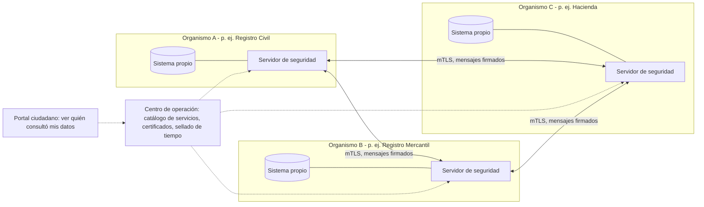

# VEP-0100: Plataforma Nacional de Interoperabilidad entre organismos públicos

## Resumen

Se propone crear una plataforma que permita a los organismos públicos intercambiar datos entre sí de forma segura, auditada y descentralizada, para que **el ciudadano nunca tenga que entregarle al Estado un documento que el propio Estado ya tiene**. Cada organismo conserva sus datos; lo que se construye es una capa común de intercambio basada en estándares abiertos y software libre, con un registro de cada consulta que el propio ciudadano puede revisar.

## Problema

Hoy, cuando un venezolano hace un trámite, actúa como "mensajero" entre organismos públicos: pide una constancia en un sitio, la imprime, la lleva a otro, espera y repite. Esto tiene varias consecuencias:

1. **Pérdida de tiempo y dinero** para ciudadanos y empresas, que multiplican colas, desplazamientos y copias.
2. **Corrupción.** Cada paso manual y cada documento en papel es una oportunidad para cobrar por "agilizar" o "resolver".
3. **Datos inconsistentes.** Cada organismo mantiene su propia copia de los datos de las personas, que se desactualiza y contradice con las demás.
4. **Imposibilidad de diseñar políticas con datos.** Sin intercambio, el Estado no puede cruzar información para focalizar ayudas o detectar fraudes.
5. **Barreras para la diáspora.** Quien vive fuera no puede hacer trámites que exigen presentarse con papeles físicos.

*Datos pendientes: número medio de documentos exigidos en los trámites más frecuentes y tiempos de respuesta (ver Preguntas abiertas).*

## Propuesta

### Principios de diseño

1. **Solo una vez.** El ciudadano entrega un dato una sola vez; después, los organismos lo consultan entre sí.
2. **Descentralización.** No existe una gran base de datos central. Cada organismo sigue siendo el dueño y responsable de sus datos.
3. **Seguridad por diseño.** Todo intercambio va cifrado, autenticado y firmado.
4. **Trazabilidad.** Cada consulta queda registrada: quién consultó, qué dato, cuándo y con qué base legal.
5. **Transparencia hacia el ciudadano.** Cada persona puede ver qué organismos han consultado sus datos.
6. **Estándares abiertos y software libre.** Sin dependencia de un único proveedor.
7. **Mínimo privilegio.** Cada organismo accede solo a los datos que necesita para un fin legalmente definido.

### Arquitectura

**Componentes:**

| Componente | Función |
|------------|---------|
| **Servidor de seguridad** (uno por organismo) | Punto único de entrada y salida de datos del organismo. Cifra, firma, autentica y registra cada mensaje. |
| **Centro de operación** | Mantiene el catálogo de organismos y servicios, gestiona los certificados y emite sellos de tiempo. **No ve ni almacena los datos** que se intercambian. |
| **Infraestructura de clave pública (PKI)** | Emite los certificados de los organismos. Puede apoyarse en la autoridad de certificación electrónica existente (SUSCERTE), con las garantías de independencia necesarias. |
| **Catálogo de servicios** | Lista pública de qué datos ofrece cada organismo, con su contrato de interfaz (OpenAPI) y su base legal. |
| **Registros de auditoría** | Cada servidor de seguridad guarda un registro inalterable de las consultas enviadas y recibidas. |
| **Portal ciudadano** | Permite a cada persona consultar el historial de accesos a sus datos. |

**Estándares técnicos:**

- Comunicación: HTTPS con autenticación mutua (mTLS) entre servidores de seguridad.
- Interfaces: APIs REST descritas con OpenAPI; se admite SOAP para sistemas heredados.
- Identificadores únicos: cédula de identidad para personas y RIF para empresas, como claves comunes entre registros.
- Interoperabilidad semántica: un modelo de datos común para los conceptos básicos (persona, empresa, dirección, inmueble), publicado como estándar abierto.

**Tecnología base:** se propone evaluar **X-Road**, la plataforma de interoperabilidad de código abierto creada por Estonia y mantenida hoy por el Nordic Institute for Interoperability Solutions (NIIS), adoptada ya por varios países. Usarla evita construir desde cero la parte más compleja y mejor probada del sistema, y permite concentrar el esfuerzo en conectar los sistemas venezolanos.

### Registros base (primera ola)

El valor de la plataforma depende de conectar primero los registros que más se piden en los trámites:

| Registro | Datos clave | Ejemplo de uso |
|----------|-------------|----------------|
| Identidad (SAIME) | Identidad, cédula | Verificar la identidad en cualquier trámite |
| Registro civil | Nacimientos, matrimonios, defunciones | Inscripción escolar, pensiones, herencias |
| Registro mercantil (SAREN) | Empresas, representantes legales | Apertura de cuentas, licitaciones |
| Administración tributaria (SENIAT) | RIF, solvencia tributaria | Contratación pública, permisos |
| Seguridad social (IVSS) | Afiliación, cotizaciones | Pensiones, prestaciones |
| Catastro y registro inmobiliario | Propiedad de inmuebles | Compraventas, créditos hipotecarios |

### Marco legal y gobernanza

- **Ley de interoperabilidad** (o reforma del marco vigente, que ya recoge algunos principios en la Ley de Infogobierno de 2013) que establezca:
  - La obligación de los organismos de consultar los datos que ya tiene el Estado en lugar de pedirlos al ciudadano.
  - El derecho del ciudadano a conocer quién consulta sus datos.
  - Que todo intercambio necesita una base legal publicada en el catálogo.
  - Sanciones por accesos indebidos.
- **Autoridad de interoperabilidad**, un organismo técnico que opera el centro de operación, publica los estándares y certifica a los organismos que se conectan.
- **Vinculación con la futura ley de protección de datos personales** (ver el área de [Tecnología](../areas/tecnologia/)).

### ¿Quién lo ejecuta?

- Asamblea Nacional: marco legal.
- Autoridad de interoperabilidad: operación del núcleo y estándares.
- Cada organismo: su servidor de seguridad y la adaptación de sus sistemas.
- Comunidad técnica (incluida la diáspora): revisión de estándares, desarrollo de adaptadores y auditorías de seguridad independientes.

## Experiencias comparables

| País / región | Qué hicieron | Resultado | Lección para Venezuela |
|---------------|--------------|-----------|------------------------|
| Estonia | X-Road desde 2001, como base de casi todos sus servicios públicos digitales | Referencia mundial en gobierno digital; el ciudadano ve quién consulta sus datos | La descentralización y la trazabilidad generan confianza |
| Finlandia | Adoptó X-Road y comparte su desarrollo con Estonia mediante NIIS | Intercambio de datos transfronterizo entre ambos países | Se puede reutilizar tecnología probada en lugar de reinventarla |
| Uruguay | Plataforma de interoperabilidad gestionada por AGESIC | Uno de los países más avanzados de la región en gobierno digital | Una agencia técnica estable y con continuidad es clave |
| Unión Europea | Principio de "solo una vez" y sistema técnico para compartir pruebas entre países | Marco común para 27 países con sistemas muy distintos | Los estándares semánticos importan tanto como la tecnología |

*Pendiente: incorporar la experiencia de Colombia y otros países latinoamericanos que han adoptado X-Road o soluciones similares.*

## Costos y financiamiento

- **Software:** X-Road es de código abierto, por lo que no hay costo de licencias.
- **Costo principal:** la adaptación de los sistemas de cada organismo, que en muchos casos son antiguos o están en papel, y la formación de sus equipos técnicos.
- **Infraestructura:** servidores de seguridad en cada organismo y un centro de operación con redundancia.
- **Financiamiento posible:** presupuesto nacional, cooperación técnica de otros países y préstamos de la banca multilateral para modernización del Estado (BID, CAF, Banco Mundial).
- **Retorno:** ahorro de tiempo para ciudadanos y empresas, reducción de fraudes y de la corrupción en los trámites, y menos personal dedicado a verificar papeles.

*Pendiente: estimación de costos por organismo con base en experiencias comparables.*

## Plan de implementación

| Fase | Plazo estimado | Acciones clave | Indicador de éxito |
|------|----------------|----------------|--------------------|
| 1. Fundamentos | 0-12 meses | Marco legal, autoridad de interoperabilidad, PKI, centro de operación, modelo de datos común | Ley aprobada y núcleo técnico operativo |
| 2. Piloto | 6-18 meses | Conectar 3 registros base (identidad, registro civil, registro mercantil) y digitalizar un trámite completo, como la creación de empresas | Trámite piloto sin papeles de principio a fin |
| 3. Expansión | 18-36 meses | Conectar el resto de registros base y los 20 trámites más frecuentes; lanzar el portal ciudadano | Mayoría de trámites frecuentes sin documentos en papel |
| 4. Territorio | 3-5 años | Conectar gobernaciones y alcaldías; abrir servicios al sector privado autorizado (bancos, notarías) | Organismos regionales y locales conectados |

**Estrategia técnica para los sistemas heredados:** en lugar de esperar a modernizar cada sistema, se construyen adaptadores que exponen sus datos a través del servidor de seguridad. La modernización interna de cada organismo puede ir a su ritmo sin bloquear la interoperabilidad.

## Riesgos y cómo mitigarlos

| Riesgo | Probabilidad | Impacto | Mitigación |
|--------|--------------|---------|------------|
| Uso de la plataforma para vigilancia o persecución | Media | Alto | Sin base de datos central, base legal para cada consulta, registro visible para el ciudadano, sanciones y auditorías independientes |
| Sistemas antiguos sin interfaces o en papel | Alta | Medio | Adaptadores; digitalización progresiva empezando por los registros más consultados |
| Cortes de electricidad y conectividad | Alta | Alto | Redundancia en el centro de operación, alimentación de respaldo, reintentos y operación asíncrona |
| Resistencia de los organismos a compartir datos | Alta | Medio | Obligación legal, indicadores públicos por organismo, apoyo técnico |
| Datos de mala calidad o duplicados | Alta | Medio | Programa de depuración de los registros base antes de conectarlos |
| Ciberataques | Media | Alto | CSIRT nacional, pruebas de penetración periódicas, auditoría pública del código |
| Dependencia de proveedores | Baja | Medio | Software libre, estándares abiertos, capacidades técnicas propias |
| Fuga de talento técnico del Estado | Alta | Alto | Salarios competitivos para perfiles críticos, colaboración con la diáspora |

## Impacto social y territorial

- **Gana todo el mundo que hace trámites**, y en especial quienes viven lejos de las oficinas centrales, que hoy se desplazan más para cada gestión.
- **La diáspora** podría hacer trámites a distancia, sin viajar ni depender de intermediarios.
- **Brecha digital:** hay que mantener la atención presencial. La diferencia es que el funcionario consulta los datos en el sistema en lugar de exigir papeles al ciudadano.
- **Pierden** quienes hoy se benefician de la opacidad y de cobrar por "agilizar" los trámites.

## Cómo mediremos el éxito

- Número de organismos y servicios conectados a la plataforma.
- Número de documentos que el ciudadano deja de presentar en los trámites más frecuentes.
- Tiempo medio de los trámites piloto antes y después.
- Disponibilidad de la plataforma (porcentaje del tiempo operativa).
- Porcentaje de consultas con base legal registrada (objetivo: 100%).
- Número de ciudadanos que consultan quién ha accedido a sus datos.

## Alternativas consideradas

- **Una gran base de datos central del Estado:** más sencilla de construir, pero crea un punto único de fallo, un objetivo prioritario para ataques y una herramienta de control político. Se descarta.
- **Integraciones punto a punto entre organismos:** es lo que existe hoy de forma parcial. Con muchos organismos, el número de conexiones crece de forma inmanejable y cada una tiene su propia seguridad. Se descarta.
- **Bus de servicios centralizado (ESB):** mejora el orden, pero concentra el tráfico y el control en un solo punto y suele depender de un proveedor. Se descarta frente al modelo distribuido.
- **Comprar una plataforma propietaria:** más rápido al principio, pero genera dependencia y costos de licencia permanentes. Se descarta frente a X-Road u otra alternativa de código abierto.

## Preguntas abiertas

- ¿Qué organismos tienen hoy sistemas digitales capaces de exponer datos y cuáles trabajan todavía en papel?
- ¿Qué establece exactamente la Ley de Infogobierno sobre interoperabilidad y hasta qué punto se ha aplicado?
- ¿Qué trámite piloto genera más impacto con menos esfuerzo?
- ¿Dónde debe alojarse el centro de operación y cómo se garantiza su continuidad ante cortes eléctricos?
- ¿Cómo se garantiza la independencia de la autoridad de interoperabilidad frente al gobierno de turno?
- ¿Qué experiencias latinoamericanas con X-Road son más comparables con Venezuela?

## Referencias

1. Nordic Institute for Interoperability Solutions (NIIS). Documentación de X-Road.
2. e-Estonia. Documentación pública sobre X-Road y el sistema de identidad digital.
3. AGESIC (Uruguay). Documentación de la Plataforma de Interoperabilidad.
4. Comisión Europea. Principio de "solo una vez" y *European Interoperability Framework*.
5. *Pendiente: Ley de Infogobierno (2013) y normativa venezolana sobre firma electrónica.*

---

## Historial de cambios

| Fecha | Cambio | Autor |
|-------|--------|-------|
| 2026-09-29 | Versión inicial | silvinux |
